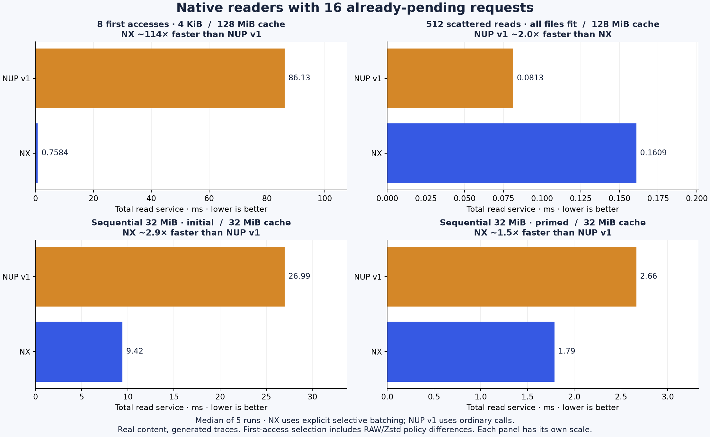
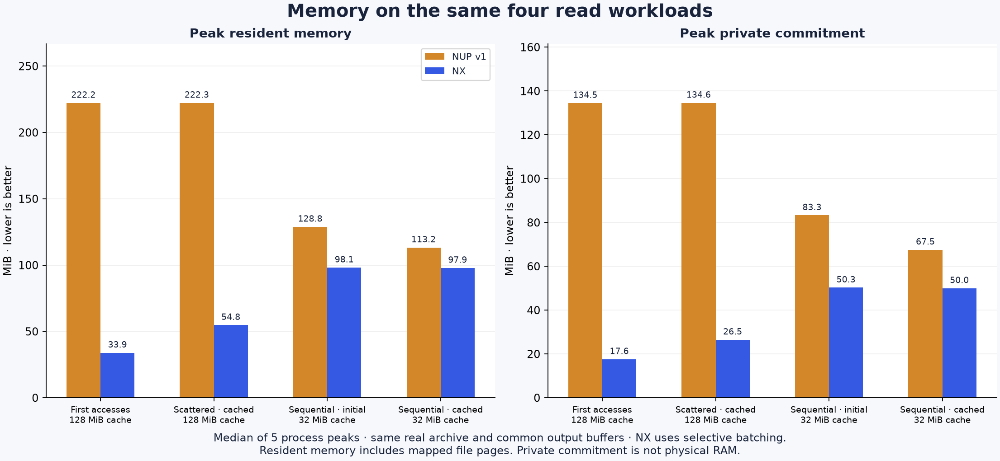

<p align="center">
  
</p>

<p align="center">
  <a href="LICENSE"></a>
  <a href="https://github.com/fab918/nxformat/actions/workflows/ci.yml"></a>
  <a href="https://github.com/fab918/nxformat/releases/latest"></a>
</p>

NX is an archive format for decrypted Nintendo Switch and Switch 2 games.
One `.nx` file holds a base game, its updates and its DLC. NXConvert creates
and edits these files; a header-only C++17 reader lets emulators load them.

- Files are split into independent RAW or Zstd blocks, so a random read only
  decodes the block it needs.
- Identical blocks are stored once, across files, updates and DLC.
- Updates and DLC can be added or removed later without rewriting the base.
- Every read is checked with CRC-32C; `verify` checks every file SHA-256.
- A small recipe (about 2 KB for a gamecard) can rebuild the original
  DNSP/DXCI byte for byte. `--no-recipe` turns it off.
- Input: decrypted DNSP/DXCI, extracted folders and NUP archives.

NXConvert does not decrypt anything. It only repacks game files you have
already decrypted from games you own. It contains no keys and no game data.

## Download

Get NXConvert from the [releases page](https://github.com/fab918/nxformat/releases)
(Windows, Linux, macOS). Android archives contain the libraries only.

To build it yourself (Rust 1.95 or newer):

```bash
cargo build --release --locked --manifest-path app/Cargo.toml
```

The binary is `app/target/release/nxconvert`.

## Usage

Run `nxconvert` with no arguments to open the window, or use the command line:

```bash
nxconvert pack game.dnsp game.nx            # create an archive
nxconvert add game.nx update.dnsp           # add an update or DLC
nxconvert contents game.nx                  # list what is stored
nxconvert remove game.nx SNAPSHOT_IDENTITY  # remove a version or DLC
nxconvert verify game.nx                    # full integrity check
nxconvert compact game.nx                   # reclaim unused space
nxconvert pack-nup game.nup game.nx --platform switch2
nxconvert extract game.nx folder/           # export the game files
```

`nxconvert --help` lists every command and option.

`extract` also writes `.nxrestore.zst` in the folder. As long as the files are
unchanged, `nxconvert pack-tree folder/ game.nx` gives back the exact original NX.

## Performance

Native C++ readers, same compiler, same Zstd library, same real archive. NUP
uses [Eglantine's reader](https://github.com/fab918/Eglantine/blob/6da821f83f402cb288f6d078b9e3c21955e0b54f/src/core/file_sys/nup_container.cpp)
unmodified. Median of five runs, 16 pending requests, OS cache not flushed.



| Read time (ms, lower is better) | Cache | NUP v1 | NX |
|---|---:|---:|---:|
| 8 first accesses, 4 KiB | 128 MiB | 86.129 | **0.758** |
| 512 scattered reads, all cached | 128 MiB | **0.081** | 0.161 |
| Sequential 32 MiB, first pass | 32 MiB | 26.989 | **9.418** |
| Sequential 32 MiB, second pass | 32 MiB | 2.663 | **1.788** |



| Peak resident / private memory (MiB) | NUP v1 | NX |
|---|---:|---:|
| 8 first accesses | 222.3 / 134.5 | 33.9 / 17.6 |
| 512 scattered reads, all cached | 222.3 / 134.6 | 54.8 / 26.5 |
| Sequential 32 MiB, first pass | 128.8 / 83.3 | 98.1 / 50.3 |
| Sequential 32 MiB, second pass | 113.2 / 67.6 | 97.9 / 50.0 |

These are synthetic access patterns on real content, not gameplay.

## Using it in an emulator

Reading: copy the headers from [dist/](dist/). They need C++17 and a Zstd
decode callback, nothing else.

```cpp
#include "nx_session.hpp"
#include "nx_disk_source.hpp"

auto source = *nx::DiskSource::open("game.nx").value;   // check errors in real code
nx::SessionOptions options;
options.reader.zstd = my_zstd_decode;                    // see nx::ZstdDecoder
options.reader.cache_raw_verification = source->immutable_reads();
auto session = *nx::Session::open(source, options).value;
auto& archive = session->archive();                      // applications(), snapshots(), title()...
auto file = *archive.resolve_file(snapshot, "romfs/data.bin").value;
session->read(file.id, offset, length, buffer, capacity);
```

Every read is verified before bytes reach the buffer. The archive file must not
change while it is open.

Writing and editing: link the C API from the release archives.
[nxformat.h](ffi/include/nxformat.h) runs any `nxconvert` command in process,
with an output callback and a cancel handle:

```c
const char* args[] = {"contents", "game.nx", "--frontend"};
nxformat_run(args, 3, on_line, user, cancel, error, sizeof error);
```

An emulator that decrypts games itself can pass the plaintext through a read
callback instead of writing it to disk:

```c
nxformat_source* game = nxformat_source_new("game.nsp", size, read_plaintext, ctx);
const char* args[] = {"pack", nxformat_source_path(game), "game.nx", "--frontend"};
nxformat_run(args, 4, on_line, user, cancel, error, sizeof error);
nxformat_source_free(game);
```

Each release archive has `include/`, `lib/` (shared and static) and `bin/`.

CMake: point `nxformat_DIR` at `lib/cmake/nxformat` of an extracted archive.

```cmake
find_package(nxformat 1.0 REQUIRED CONFIG)
target_link_libraries(app PRIVATE nxformat::nxformat) # or nxformat::static, nxformat::static_nozstd
```

xmake: extract `nxformat-xmake-<version>.zip` from the release.

```lua
add_repositories("nxformat /path/to/nxformat-xmake")
add_requires("nxformat")
```

## Repository

| Folder | Content |
| --- | --- |
| [packer/](packer/) | Rust library and the `nxconvert` commands |
| [app/](app/) | NXConvert desktop app (egui) |
| [ffi/](ffi/) | C API |
| [reader/](reader/) | C++17 reader sources; [dist/](dist/) is the copy to vendor |
| [packages/](packages/) | xmake package recipe |
| [tests/](tests/) | Fixtures, conformance tests, fuzz target |
| [docs/](docs/) | [Format specification](docs/SPEC.md) |

## Tests

Needs Rust, Python 3.14+, a C++17 compiler and libzstd.

```bash
cargo test --locked --manifest-path packer/Cargo.toml
cargo test --locked --manifest-path ffi/Cargo.toml
python tests/conformance/validate_fixtures.py
python tests/conformance/test_reader.py
python tests/conformance/test_rust_writer.py
```

CI runs the full set on Windows, Linux and macOS. No real game files are used.

## License

[MIT](LICENSE). Not affiliated with Nintendo.
