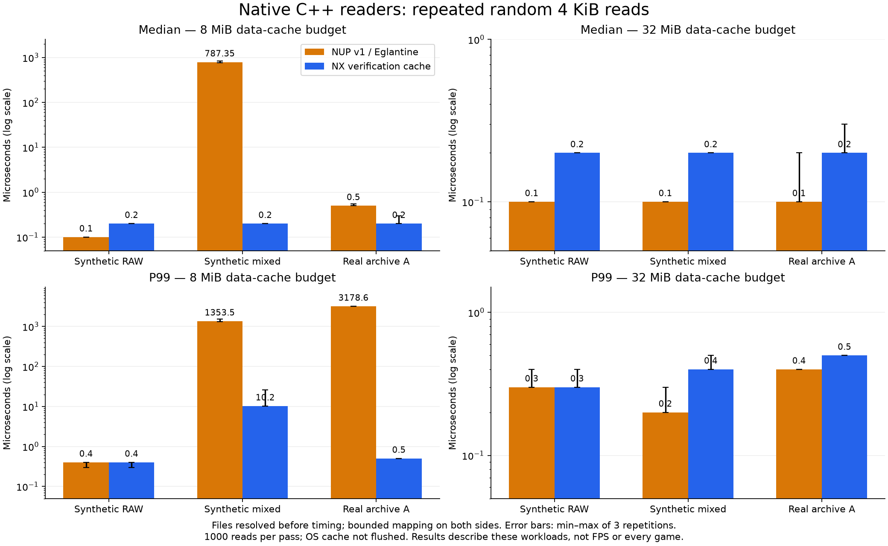
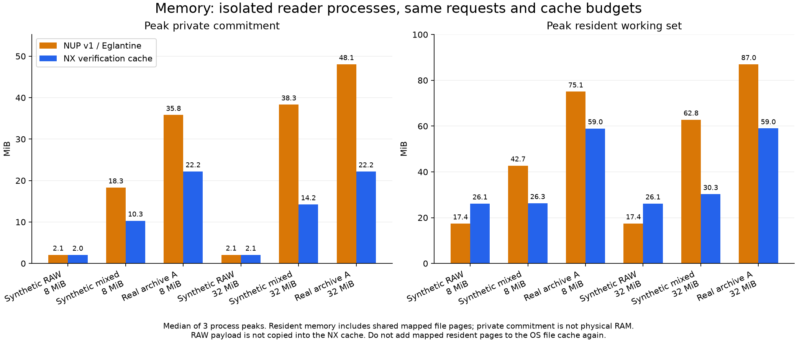
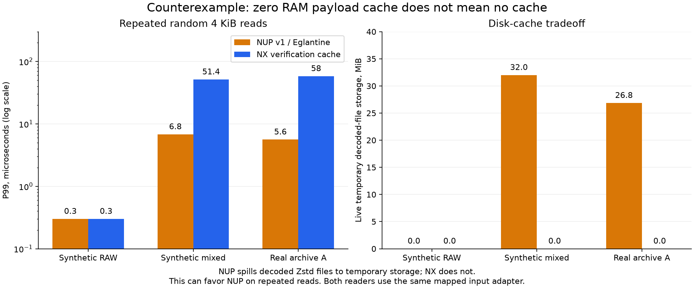

# Native NUP/NX reader comparison — 15 November 2026

This replaces the earlier Python-NUP versus C++-NX comparison. Both readers are
native C++, compiled with the same MSVC Release flags and static Zstd library.
The NUP implementation is Eglantine's unmodified `NupContainer`; no emulator
source or game content is vendored. The reference NX reader is pinned to merged
1.0.4 commit `b6a9de8`; the feature reader adds verification-only RAW caching.

## Primary comparison

Files are resolved/opened before timing. Both sides use the same bounded Windows
mapping adapter. The new NX option requires a source that guarantees immutable
bytes; checksum validation is performed before the first use of each slice.
RAW payload is never retained in an application data cache. The verification
bitmap is bounded separately (1 MiB maximum, about 8 KiB per GiB of unique logical
data), and the usual Zstd payload-cache budget remains unchanged.





The mapped provider keeps at most 64 address windows, normally 16 MiB each;
a boundary-crossing request can extend a window. These are file-backed views,
not private copies of RAW data. In-flight leases can keep an evicted view alive.
The figures include both resident memory and private commitment: neither alone
measures total system RAM. Windows file-cache pages outside the reader are not
counted. Do not add shared mapped pages to the system file cache a second time.
See [Microsoft's file mapping documentation](https://learn.microsoft.com/en-us/windows/win32/memory/file-mapping).

## Selected warm-pass numbers (32 MiB data-cache budget)

Median / P99 are in microseconds. Memory values are medians of process peaks.

| Corpus and scenario | NUP median / P99 | NX median / P99 | NUP private / resident MiB | NX private / resident MiB |
|---|---:|---:|---:|---:|
| Synthetic RAW · random_4096 | 0.1 / 0.3 | 0.2 / 0.3 | 2.1 / 17.4 | 2.1 / 26.1 |
| Synthetic RAW · hot_1mib | 0.1 / 0.1 | 0.2 / 0.2 | 2.1 / 11.5 | 2.1 / 10.9 |
| Synthetic RAW · sequential_32mib | 6.4 / 8.7 | 6.1 / 7.3 | 2.2 / 42.6 | 2.2 / 42.0 |
| Synthetic RAW · interleaved_8files | 1.2 / 1.6 | 1 / 1.2 | 2.0 / 14.4 | 1.9 / 13.8 |
| Synthetic mixed · random_4096 | 0.1 / 0.2 | 0.2 / 0.4 | 38.3 / 62.8 | 14.2 / 30.3 |
| Synthetic mixed · hot_1mib | 0.1 / 0.1 | 0.2 / 0.3 | 14.2 / 26.6 | 2.6 / 11.0 |
| Synthetic mixed · sequential_32mib | 4.1 / 12 | 5.1 / 7.8 | 38.4 / 62.9 | 15.8 / 39.6 |
| Synthetic mixed · interleaved_8files | 0.9 / 1.7 | 1.2 / 1.8 | 38.2 / 62.7 | 4.1 / 13.9 |
| Real archive A · random_4096 | 0.1 / 0.4 | 0.2 / 0.5 | 48.1 / 87.0 | 22.2 / 59.0 |
| Real archive A · hot_1mib | 0.1 / 0.1 | 0.2 / 0.2 | 21.6 / 36.6 | 17.3 / 34.9 |
| Real archive A · sequential_32mib | 3.8 / 8.6 | 7.2 / 8.9 | 39.3 / 79.3 | 22.5 / 69.3 |
| Real archive A · interleaved_8files | 0.9 / 1.9 | 1 / 1.3 | 26.8 / 46.1 | 17.6 / 37.9 |

NUP is still faster in some warm-cache and sequential cases. Differences of
0.1 microsecond are close to the clock granularity and should not be presented
as a robust speedup. Under memory pressure, the per-file NUP LRU can repeatedly
decompress whole files; small NX blocks have a different cost. These are reader
and workload measurements, not a proof of universal format superiority.

## Zero-data-cache counterexample



With a zero RAM payload-cache budget, NUP's production reader spills decoded
files to temporary storage. NX currently decodes compressed blocks again on
misses instead of creating that disk cache. NUP can therefore win repeated
compressed-file reads at the cost of temporary disk space and OS file caching.
This case is included, not discarded from the results.

## Workloads, limits and reproducibility

- Synthetic RAW and mixed-compressibility corpora: identical logical 32 MiB,
  eight 4 MiB members, generated deterministically by
  `packer/examples/native_nup_benchmark.rs`. NUP stores each file RAW or as one
  Zstd frame; NX uses its normal RAW/Zstd decision and block sizing. Thus this
  compares concrete tools/policies, not an isolated codec or format-only effect.
- Real archive A: an already converted local archive, checked read-only. A seeded
  subset of 32 members (about 74 MiB logical) is used. No game title, member path,
  content identifier, proprietary bytes or private request manifest is published.
  This is one real corpus, not a representative sample of all games.
- Seven scenarios: size-weighted random 4/64/256 KiB reads, a hot region of at
  most 1 MiB, 90% hot/10% global reads, sequential 256 KiB traversal capped at 32 MiB,
  and 64 KiB reads interleaved across eight files.
- Data-cache budgets: 0, 8 and 32 MiB. Six variants retain stdio and mapped
  controls, including the original NX reader. Three fresh isolated processes
  per configuration, two trace passes, variant order rotated between repeats.
- First reader pass is **not cold storage**: the OS file cache is not flushed.
  Mapping, metadata parsing, file resolution and output checks are outside the
  individual read timers. Process peaks include their memory costs. Throughput
  sums timed read service, not whole-process elapsed time. This is not FPS.
- Native checksum policies differ: NX validates slices and caches their verified
  state for pinned immutable sources; NUP does not do that CRC check per read.
- Quantiles are computed per repetition, then their medians are reported; samples
  are not pooled. Error bars are observed min–max over three repeats, not confidence
  intervals. P99 on 1000 requests depends on ten tail samples. Sequential and
  interleaved traces are shorter; use their throughput as well as percentiles.

The matrix ran **1134 isolated processes**, **1,682,532 sampled reads** and separately compared **62,316 complete read buffers**. Isolated modes cross-check a sampled checksum; that is distinct from the full-buffer comparisons.

[All aggregate configurations](results.csv) · [Per-repetition metrics and provenance](results.json) ·
[Selected individual samples](samples/). Older full-path lookup experiments are
kept locally as diagnostic controls, not used for the headline plots.

Run in a Windows MSVC developer shell with an existing Release Eglantine build:

```text
python benchmarks/run_low_memory_matrix.py --egl-build PATH --output results/reproduction --reads 1000 --repetitions 3 --budgets 0 8 32 --resolved
python benchmarks/publish_low_memory_results.py results/reproduction docs/benchmarks/low-memory-reader-cache
```

Optional `--real-nup FILE --real-nx FILE` uses matching local inputs. The external
NUP source revision and SHA-256 values are in `results.json`. The standalone
adapter links GPL-3.0-or-later emulator code and is GPL-3.0-or-later; that code or
its benchmark binary is not included in NXConvert release packages.

## Targeted initial access in compressed real files

[Initial versus repeated accesses](REAL_COMPRESSED.md) separately measures the eight largest compressed members with 32 and 128 MiB budgets, including byte checks and NUP-favorable repeat cases.
