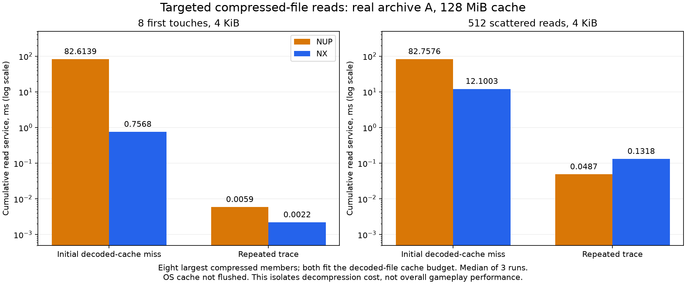

# Targeted real compressed-file access

This is a targeted architecture experiment, not an overall-game trace. It uses
**the eight largest Zstd-compressed RomFS members of real archive A**. This
selection intentionally isolates reads that need decompression, unlike a mix of
RAW, compressed and already cached data. No game content or private paths are
published. The original representative comparison remains in the main report.

Both native readers use bounded mapping and pre-resolved handles. Three fresh
processes per configuration, alternating reader order, each executes two trace
passes. The OS file cache is not flushed: the first pass has an empty decoded
application cache, **not necessarily cold storage**. Checks and opening are outside
read timing; memory peaks include both passes. Times below sum measured read
service, excluding setup and reporting. They are medians of three repetitions.

The first-touch trace reads 4 KiB 64 KiB before the end of each selected file.
Scatter interleaves 64 seeded random reads per file. Sequential traversal uses
256 KiB requests and is capped at 32 MiB. Both full passes are compared byte for
byte separately from isolated timing processes.

The eight files range from 8.79 to 17.48 MiB, totaling 107.50 MiB decoded. Thus the 128 MiB NUP budget can retain all eight files; the 32 MiB budget cannot. Full-buffer comparisons: **2592**.

| Scenario | Budget MiB | NUP first / repeat ms | NX first / repeat ms | NUP / NX peak resident MiB |
|---|---:|---:|---:|---:|
| 8 first touches, 4 KiB | 32 | 94.2288 / 63.6174 | 0.7676 / 0.0020 | 188.5 / 34.8 |
| 8 first touches, 4 KiB | 128 | 82.6139 / 0.0059 | 0.7568 / 0.0022 | 223.2 / 34.8 |
| 512 scattered reads, 4 KiB | 32 | 4046.7074 / 4029.4998 | 12.1462 / 0.1628 | 188.7 / 55.5 |
| 512 scattered reads, 4 KiB | 128 | 82.7576 / 0.0487 | 12.1003 / 0.1318 | 223.3 / 55.5 |
| Sequential 256 KiB, up to 32 MiB | 32 | 24.6905 / 1.6124 | 7.2771 / 0.7402 | 97.0 / 65.9 |
| Sequential 256 KiB, up to 32 MiB | 128 | 13.8923 / 0.4674 | 7.3443 / 0.6961 | 96.5 / 66.0 |



NX avoids decoding unrelated parts when reading compressed blocks, and can
read RAW blocks directly. A subsequent codec inspection found **five RAW and
three Zstd starting blocks** for these eight initial requests in NX, while all
eight source members are Zstd-compressed in NUP. The ~109x result therefore
includes the tools' compression-policy choices; it does not isolate independent
block decompression alone. Both original archives are unchanged.

With 128 MiB, NUP pays whole-file decompression once and then serves cached bytes.
Its warm scatter and sequential traces beat NX; those results remain in the table.
With 32 MiB, cycling through these files repeatedly evicts NUP decoded files,
whereas NX retains the accessed blocks. This is a deliberate working-set stress
case, not evidence that every game behaves this way.

Memory values are resident process peaks, including file-backed mapped pages;
they do not measure total system RAM. Private commitment, live temporary decoded
file storage and individual repetition metrics are in
[the complete measurements](real-compressed-results.json). NUP's 32 MiB case also
uses temporary storage for the member exceeding half its cache budget; its
128 MiB case does not need temporary decoded storage.

Reproduce using the native adapter built by the main matrix:

```text
python benchmarks/run_real_compressed_traces.py --nup LOCAL.nup --nx LOCAL.nx --adapter results/native/verification/native-nup-comparison.exe --output results/real-compressed
```

Inputs must contain matching logical content. Source provenance is included in
the JSON; all private request manifests stay under the ignored results directory.
