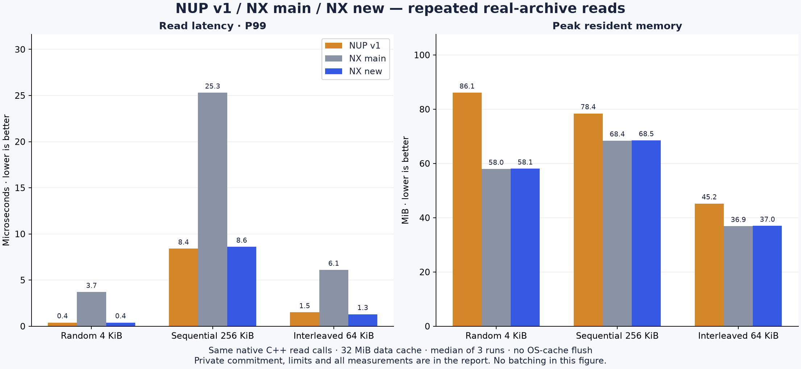
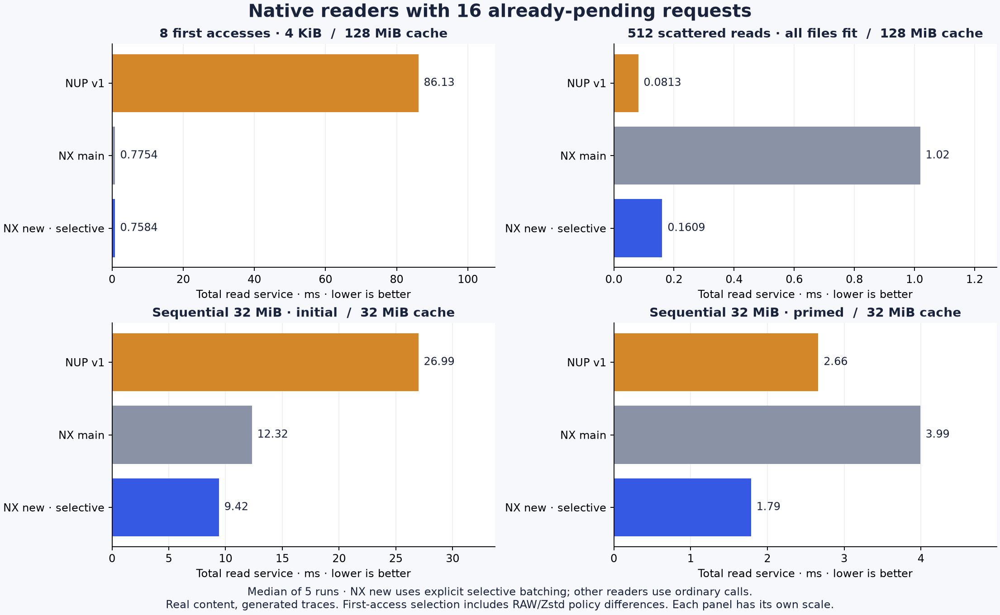

# Fresh NUP v1 / NX main / NX new comparison — 15 November 2026

- **NX main (called master in the request):** `b6a9de8b8f5db52b1b79d52dee54560ea3a71101`.
- **NX new:** `5d4810a7db66d3b72cbb3e4bffafc5d54c57eed8`; immutable-source verification reuse enabled.
- **NUP v1:** unchanged native Eglantine reader; source revision and hashes in the
  process reports. All variants compiled with the same MSVC Release flags and
  static Zstd. Same bounded mapped input provider; handles resolved before reads.
- Machine: AMD Ryzen 7 9800X3D, Windows 11 26200. OS cache not flushed. The first
  application pass is not a cold-disk test. Generated traces, not recorded gameplay.

## 1. Same synchronous read calls

No batching or prefetch. Three isolated repetitions per configuration; two passes.
The reader-only verification hint does not change ordinary reads by itself.
Times: median / P99 in microseconds, median of per-run quantiles on the repeated
pass. NX main verifies RAW slices each read; NX new reuses verification only for
pinned immutable inputs. NUP has a different integrity-check policy.

| Corpus / access pattern | Cache MiB | NUP v1 | NX main | NX new |
|---|---:|---:|---:|---:|
| raw / random_4096 | 32 | 0.1 / 0.4 | 1.8 / 3.5 | 0.2 / 0.4 |
| zstd / random_4096 | 32 | 0.1 / 0.3 | 0.6 / 3.9 | 0.3 / 0.6 |
| real_A / random_4096 | 32 | 0.1 / 0.4 | 1.9 / 3.7 | 0.2 / 0.4 |
| real_A / random_4096 | 8 | 0.5 / 3153.4 | 1.9 / 3.7 | 0.2 / 0.5 |
| real_A / sequential_32mib | 32 | 4.6 / 8.4 | 9.6 / 25.3 | 6.6 / 8.6 |
| real_A / interleaved_8files | 32 | 0.9 / 1.5 | 5.7 / 6.1 | 1 / 1.3 |

### Memory for the same synchronous workloads

Peak **resident / private commitment**, MiB, medians of process peaks (both
passes combined). Private commitment is not physical RAM. Resident memory
includes mapped file pages; neither is total system memory. Do not count shared
mapped pages again as an additional copy of the OS file cache.

| Corpus / access pattern | Cache MiB | NUP v1 | NX main | NX new |
|---|---:|---:|---:|---:|
| raw / random_4096 | 32 | 16.48 / 2.01 | 25.17 / 2.02 | 25.18 / 2.04 |
| zstd / random_4096 | 32 | 61.82 / 38.22 | 29.38 / 14.18 | 29.32 / 14.18 |
| real_A / random_4096 | 32 | 86.07 / 48.00 | 57.96 / 22.04 | 58.05 / 22.14 |
| real_A / random_4096 | 8 | 74.09 / 35.82 | 57.96 / 22.05 | 58.06 / 22.13 |
| real_A / sequential_32mib | 32 | 78.45 / 39.25 | 68.41 / 22.39 | 68.49 / 22.49 |
| real_A / interleaved_8files | 32 | 45.22 / 26.82 | 36.88 / 17.48 | 36.98 / 17.52 |



## 2. Explicit pending-read batches

All four variants receive the same 16 already-pending requests, same timing
windows, buffers and output staging. NUP/main/new-direct perform ordinary reads;
new-selective also uses the locality gate, 125% span cap and verified-range hint.
This is an explicit integration policy, not an automatic improvement to every
synchronous API. No queue-fill delay is modeled. Five rotated repetitions.
Full original-order output SHA-256 is compared for every process and budget.

Times are cumulative foreground read service, ms. Resolution, priming, output-file
writing and destruction are excluded. Initial/replay mean decoded application
cache state; the OS cache is uncontrolled. Memory peaks include common full-output
staging (up to 32 MiB), priming, metadata and decoder scratch. A primed replay can still miss when the decoded working set exceeds the cache; the 128 MiB random control fits all eight files. They therefore must
not be compared directly to memory in the SDK-only table above.

| Real trace | Cache MiB | Primed | NUP v1 | NX main | NX new direct | NX new selective |
|---|---:|---|---:|---:|---:|---:|
| first_touch4k | 128 | False | 86.1287 | 0.7754 | 0.7960 | 0.7584 |
| random4k | 128 | True | 0.0813 | 1.0190 | 0.1924 | 0.1609 |
| random4k | 32 | True | 3014.0200 | 1.0294 | 0.1719 | 0.1423 |
| sequential64k | 32 | False | 26.9889 | 12.3208 | 10.9729 | 9.4175 |
| sequential64k | 32 | True | 2.6634 | 3.9907 | 1.7216 | 1.7879 |
| clustered4k | 0 | False | 131.5540 | 8.5271 | 7.2009 | 1.2305 |
| clustered4k | 32 | True | 145.2050 | 0.8723 | 0.1360 | 0.1267 |
| bursty4k | 32 | True | 469.7440 | 0.6788 | 0.1222 | 0.1075 |

### Memory for pending batches

Peak **resident / private commitment**, MiB, same cases and process peaks.

| Real trace | Cache MiB | Primed | NUP v1 | NX main | NX new direct | NX new selective |
|---|---:|---|---:|---:|---:|---:|
| first_touch4k | 128 | False | 222.25 / 134.50 | 33.88 / 17.66 | 33.93 / 17.73 | 33.92 / 17.58 |
| random4k | 128 | True | 222.30 / 134.59 | 54.76 / 26.39 | 54.78 / 26.57 | 54.80 / 26.48 |
| random4k | 32 | True | 189.55 / 84.25 | 54.77 / 26.50 | 54.79 / 26.54 | 54.85 / 26.59 |
| sequential64k | 32 | False | 128.84 / 83.27 | 97.80 / 49.93 | 97.85 / 50.00 | 98.11 / 50.25 |
| sequential64k | 32 | True | 113.21 / 67.55 | 97.80 / 50.00 | 97.86 / 49.99 | 97.86 / 49.96 |
| clustered4k | 0 | False | 129.46 / 24.05 | 37.03 / 19.48 | 37.09 / 19.54 | 37.21 / 19.58 |
| clustered4k | 32 | True | 185.02 / 79.68 | 37.49 / 19.60 | 37.49 / 19.60 | 37.56 / 19.67 |
| bursty4k | 32 | True | 189.56 / 84.20 | 38.74 / 20.55 | 38.78 / 20.59 | 38.82 / 20.55 |



## Limits, checks and complete data

The selected first-access case targets eight NUP-compressed files. Of their eight
requested starting blocks in NX, five are RAW and three Zstd. Its result includes
writer storage-policy differences, not independent decompression alone. Archive
sizes and encoding counts for the synchronous subsets are in the process report.
NUP can win fully cached reads. With zero RAM cache, it can retain decoded content
in temporary files, while NX currently decodes again instead of doing that disk
caching. Live temporary-file bytes are reported separately; their OS-cache memory
outside the reader process is not measured. No FPS or universal speedup claim.

Per-repetition quantiles are aggregated without pooling. Sub-microsecond differences
approach clock granularity. Observed ranges are not statistical confidence intervals.
All memory/latency conclusions apply to these concrete tools, policies and inputs.

- [Synchronous aggregates](sync-results.csv) and [all synchronous process metrics](sync-processes.json.gz).
- [Batch aggregates](batch-results.csv) and [all batch process metrics](batch-processes.json.gz).

The synchronous matrix ran **1134 processes**, **1,682,532 sampled reads** and **62,316 separate full-buffer comparisons**. The pending-batch campaign ran **760 processes**, all with full-output equality checks. No game content or private member paths are published.

Reproduce in an MSVC developer shell using the native comparison tools:

```text
python benchmarks/run_low_memory_matrix.py --egl-build BUILD --synthetic-corpus CORPUS --real-nup LOCAL.nup --real-nx LOCAL.nx --output results/three-way --reads 1000 --repetitions 3 --budgets 0 8 32 --resolved
python benchmarks/run_native_three_way.py --egl-build BUILD --nup LOCAL.nup --nx LOCAL.nx --synthetic CORPUS --traces PRIVATE_TRACE_DIR --first-touch PRIVATE_FIRST_TOUCH.tsv --output results/three-way-batch
python benchmarks/publish_native_three_way.py results/three-way results/three-way-batch docs/benchmarks/three-way-reader-2026-11-15
```

Generate matching private traces with `run_batch_prefetch_probe.py` and
`run_real_compressed_traces.py`. The former produces `real/raw/mixed-*-private.tsv`.
The adapter links external GPL-3.0-or-later NUP code and is GPL-3.0-or-later;
no emulator source, benchmark binary or game content is vendored in releases.
